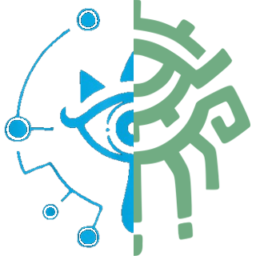

# PhysicsTool



PhysicsTool is a Windows editor for Nintendo Havok physics files used by *The Legend of Zelda: Breath of the Wild* and *Tears of the Kingdom*.

It works with complete physics graphs rather than isolated values: cloth simulations, skeletons, particles, constraints, colliders, operators, buffers, and the format-specific metadata that connects them.

> **Open beta:** PhysicsTool is actively being tested against real game files. Back up every file, keep a known-good original, and test changes in-game. Please report issues, failed merges, or reproducible crashes on Discord: **`kb0mbyolo`**.

## Supported Files

| Format | Game / purpose | Current support |
| --- | --- | --- |
| `.hkcl` | BotW Havok cloth | Open, save, merge, remove, duplicate, rename, inspect, directly edit, and convert to BPHCL. |
| `.bphcl` | TotK Phive/Havok cloth | Open, save, merge, remove, duplicate, rename, inspect, directly edit, and convert to HKCL. |
| `.bphhb` | TotK helper-bone configuration | Open, save, edit, merge independent driver groups, add, duplicate, rename, mirror, reorder, and convert to BotW `.bphyssb`. This is not a full actor skeleton. |
| `.bphyssb` | BotW support-bone configuration | Open, inspect, save, edit, merge independent driver groups, and convert to TotK `.bphhb`. |
| `.hkrg` | BotW Havok ragdoll | Open, save, inspect, and edit model bones, ragdoll bones, rigid bodies, and supported constraints. |
| `.hkrb` / `.hksc` / `.shksc` / `.sbactorpack` | BotW collision | Open, preview, and export collision geometry; create Wii U static compounds and Wii U or Switch actor rigid bodies from common 3D model formats. |
| `.sbactorpack` / `.bactorpack` | BotW actor viewer | Read-only Wii U and Switch models, skeletal animations, cloth, support bones, and ragdoll overlays. |
| `.json` | PhysicsTool diagnostic export | Open and export for inspection. It is not the recommended authoring workflow. |

PhysicsTool can also export a BotW `.bphysics` AAMP sidecar for an HKCL file. That sidecar can reference a `.bphyssb` support-bone path.

## What You Can Do

The **Documentation** button beside Settings opens a searchable offline cloth guide. It covers particles and mass, manual authoring, constraint types and use cases, collider shapes and masks, bindings, simulation settings, saving/conversion, troubleshooting, and current limitations. The guide is also available during simulation.

### Manual Cloth Authoring

- Use **New** to start a donor-free cloth in BotW Wii U HKCL, BotW Switch HKCL, or TotK BPHCL. A draft starts with one particle and a Root bone; place additional particles manually.
- Select two particles and press **F**, or use **Add constraint** in the relationships pane, to choose a distance link, directed stretch limit, or bend/stretch range. Lengths default to the current geometry. Hover over the controls for descriptions of native stiffness and endpoint order.
- The dialog explains invalid selections/ranges and warns when fixed particles or zero stiffness would prevent movement. Two endpoints must be distinct; length must be positive, and bend minimum cannot exceed maximum. Duplicate links in the target set are rejected. Topology editing is unavailable during simulation.
- Select three particles and press **F** to create a triangle and its distance-link edges. New faces do not automatically generate virtual collision points or output-bone skinning.
- The constraint chooser also describes seven additional families found in both games. These are marked **inspect only**, not offered as working creation tools without their required bindings and runtime data.
- New files are **unbound drafts**, not finished actor resources. Model-skin bindings, output-bone mappings, and actor registration are not generated automatically. Save backups and validate authored files in-game before distribution.

### HKCL Cloth

- Merge complete cloth units between compatible HKCL files.
- Remove, duplicate, and rename cloths. Duplicating a cloth also duplicates its owned colliders.
- Directly edit particles, cloth bones, and colliders.
- Moving or rotating a bone also carries its attached colliders and colliders attached to descendants, during viewport transforms and saved edits. Cancel and undo restore the attachment positions.
- Add particles, bones, capsule/sphere/plane colliders, and particle links.
- Inspect and edit supported particle-relationship values, including rest lengths, standard stiffness, bend ranges, bend stiffness, stretch stiffness, and local range data.
- Select a particle's active cloth colliders through **Colliders** instead of manually constructing its collision bitmask.
- Move, rotate, scale, mirror, copy, paste, and X-flipped paste viewport items.
- Run the built-in **preview** simulation with optional wind. It never writes simulated motion back into the file.
- Simulation settings preserve collision tolerance in the native simulation-info object. Damping uses the native 0..1 per-second fraction; invalid simulation values are rejected before changing the document.
- Cloth references preserve native skinning block order, authored reference points, and bind scale. Particle edits rebase packed/unpacked skin references and local-range centers, including repeated padding slots, so native skinning does not silently restore an old edited position.
- Export Wii U or Switch HKCL, JSON, or a BotW BPHYSICS sidecar.

### BPHCL Cloth

- **Add Particle**, copy/paste, and mirrored paste now write native BPHCL records. Related pose arrays, simulation buffers, initialization mappings, masks, and virtual-collision lookups grow together.
- Edit fixed/free state and choose a particle's colliders. Fixed-particle bindings and mass/radius summaries are maintained automatically.
- Add distance, directed stretch, and bend/stretch constraints, including a new native constraint set when needed. An empty execution list uses all sets; explicit schedules retain their order and receive the new set before the first collision call. Duplicate detection respects directed stretch links.
- Delete particles in supported layouts. Particle records, stored poses, triangles, constraints, fixed bindings, initialization mappings, and simple output-bone triangle references are remapped together. Packed virtual-collision data and unsupported operator/constraint layouts reject deletion without changing the document.
- Remove colliders from a cloth and compact its masks and simulation selections without removing colliders shared by other cloths. Remove individual standard/stretch/bend/surface-bending links and regular/stiffness local-range records.
- Create ordinary triangles with three selected particles. New particles and triangles do not automatically acquire virtual collision points or model-skin bindings. Creating/deleting BPHCL bones and creating BPHCL colliders remain unsupported. Keep originals and verify edited files in-game; native BPHCL simulation remains unavailable.

- Merge complete native BPHCL cloth packages, including their paired skeleton, particles, constraints, referenced colliders, AAMP registration, object references, and required TYPE metadata.
- Remove unused cloth packages and compact their native data when the file layout permits it.
- Directly edit supported particles, bones, colliders, triangles, and numeric constraint values.
- Bone parent indices and XYZ scale values are editable and saved natively. Rotation fields show Euler XYZ radians using BFRES/Toolbox's `qZ * qY * qX` convention; edits are converted to quaternions before saving. Simulation remains quaternion-based. Euler angles have equivalent representations, so displayed values can wrap; singular poses use a canonical representation.
- Colliders and authored bone-weighted particles follow bone and ancestor edits. Both fixed and free particles use their actual skin weights, including initialization/local-range bindings; unweighted particles are left alone. Live drag, cancel, undo/redo, and save/reload preserve these edits. Scaling/reflection of a collider-bound hierarchy is rejected rather than writing a non-rigid collider transform.
- Unsaved edits survive cloth rename, removal, and merges, including edits in the donor. Capsule endpoint edits update derived shape data and plane equations are preserved. Tapered capsules support whole-collider movement/rotation; endpoint/radius reshaping remains read-only until their derived cone data is supported.
- Duplicate, rename, and mirror cloth geometry. Mirroring follows the BPHCL native payloads, not HKCL serialization.
- Use the same viewport editing tools as HKCL for supported BPHCL data.

### Support and Helper Bones

PhysicsTool calls each independent connected motion graph a **driver group**. A driver group contains the driver bone or bones that provide motion input, the curves and outputs that transform that motion, and the driven bones affected by the result. A group can have multiple drivers when their outputs converge on the same driven graph.

- Browse BPHHB and BPHYSSB files as indexed driver groups rather than one indivisible configuration.
- View each group's motion-input bones and affected bones in the right pane.
- Double-click a group, press `Enter`, or use **Editor** to open the existing bone editor scoped to that group.
- Open a same-format donor and merge one selected driver group. PhysicsTool remaps bone references, curves, outputs, poses, and native table indices into the target graph.
- Use **Create Support** on an affected bone to clone its known-good driven setup onto a new or existing target bone name. This retains the current driver relationship instead of creating an empty, disconnected record.
- Edit supported bone names and base transforms, duplicate records, and reorder records.
- Use **Mirror Group** to reflect every input and affected base pose in the selected driver group across X, including its aim/up directions, and swap recognized left/right name tokens.
- Convert BPHHB and BPHYSSB in either direction while preserving the graph structure represented by both formats.

BotW support previews use the game's swing/twist parameterization, authored driver reference poses, and linear/curve connection rules. Same-format group merging preserves both connection types and distinct driver reference frames. Conversion retains all six rotation/translation input channels in both directions and preserves explicit reference-bone indices. Files converted with older versions may need reconversion from the original BPHHB.

Helper/support groups can be removed with **Remove selected** in the list or **Delete group** in the helper editor. Deletion asks for confirmation and supports Undo/Redo, including the last group. Shared skeleton bone names are retained; only the selected motion graph is removed. BPHHB deletion currently supports pose-driven graphs and rejects unsupported driven tables or cross-group channel sharing without modifying the file.

Driver-group merging is currently same-format: BPHHB into BPHHB or BPHYSSB into BPHYSSB. Convert a donor first when moving a group between games.

### Visual Reference Models

- Use **Load Model** in any direct editor to import FBX, Wii U/Switch BFRES, or Yaz0-compressed SBFRES as a visual-only model behind cloth, skeleton, collider, ragdoll, or support/helper-bone data. BFRES loads all contained models and embedded textures; place matching `.Tex` (Switch) or `.Tex1` (Wii U) BFRES/SBFRES companions beside the model for external textures. A texture-only or animation-only BFRES is not a model.
- BFRES uses native orientation for the entire editor viewport, including particles, bones, colliders, and picking. It does not inherit the legacy FBX X reflection. Switching model formats updates this automatically; **Mirror X** remains an optional model display setting.
- Physics-only views also retain native left/right orientation. The legacy X reflection applies only while an FBX reference model is loaded.
- HKCL particle edits, including **Attach**, update simulation rest geometry and skinned attachment references together. Undo/redo restores both, so simulation does not put fixed anchors back at their previous positions. Attach snaps positions; it does not replace the existing authored skin weights.
- In the **Colliders** tab, drag a selection box to select multiple colliders. Shift-drag adds, Ctrl-drag subtracts, and Shift-click toggles individual colliders, just like particle selection. G moves the group; R/S rotate/scale around its shared center. Cancel and undo/redo apply to the entire transform. The detail fields still describe the active collider.
- **Particles follow bones**, above the editor tabs on the right, controls whether weighted particles move during bone edits (enabled by default). Turn it off to reposition bones without moving particles; bound colliders continue to follow. Animation and simulation behavior are unchanged.
- The loaded model remains available while switching physics tabs and driver groups.
- Autodesk FBX SDK bakes node and geometric transforms into the displayed geometry, converts the file's declared units to meters, and normalizes its axis system for the Havok view.
- Albedo, SPM, normal, and ambient-occlusion textures can come from embedded FBX media or external image files. For stale absolute paths, PhysicsTool also looks for the same texture filename beside the FBX and in its subfolders.
- Meshes without a readable texture use Toolbox's gray UV-test texture with colored crosses and still load normally. The fallback is embedded in PhysicsTool; BFRES texture slots remain empty until a real texture is loaded. Collision previews keep their material colors.
- **Model** controls visibility, textures, wireframe display, opacity, X mirroring, uniform scale, XYZ offset, and XYZ rotation.
- **Materials** edits each mesh independently. Every texture slot can use its own FBX UV set; shader family, SPM metal and smoothness channels, map strengths, AO, normal strength, auxiliary maps, and tint can also be adjusted. The preview decodes color and packed material maps in the same color spaces used by the reference Blender shaders and detects hard alpha cutouts automatically.
- **Import .anim** loads a Maya ASCII `.anim` file into memory for visual playback on the FBX skeleton. The bottom transport provides **Play/Pause** and **Reset Pose** icons, a numbered frame ruler with a draggable playhead, and a **Loop** checkbox. Disable Loop to stop at the last frame. Animation remains visual-only.
- In a support/helper-bone driver-group editor, the preview bones snap to the animated FBX skeleton when every driver and affected bone in that group can be matched by name. Partial matches are rejected so the graph cannot be shown in a misleading half-snapped pose.
- Eye materials use the packaged glint overlay by default. **Materials** can disable it or adjust its strength. Eye tint and sketch-line resources are shipped beside the Release executable for future/custom material layouts.
- Legacy neighboring `<model>.materials.json` layouts and older per-model presets are migrated automatically. **Save Preset** stores every model profile in one shared `presets.json` beside `PhysicsTool.exe`; matching model, mesh, and texture names load automatically.
- **Settings** changes the interface language between English, Japanese, French, and Spanish and selects animation playback speed: 60 FPS preserves the source animation speed, while 30 FPS plays at half speed. Choices are stored in the portable `settings.json` beside the executable and apply immediately; fixed dialogs expand to fit longer translated labels, while native Havok field and class names remain unchanged.
- Imported models and animations are session-only reference data. They are never written into HKCL, BPHCL, HKRG, BPHHB, or BPHYSSB files. Standalone BFRES supports cloth/helper pose deformation, but Maya `.anim` import still requires FBX; BFRES animation playback remains available through the Actor viewer.

### BotW Actor Viewer

- **Actor** and **Open actor** open a searchable catalog of actors containing or referencing cloth (`.hkcl`) or support-bone (`.bphyssb`) data, instead of a file picker. Filter for cloth, support bones, or both; platform and source columns distinguish Wii U, Switch, and alternate copies.
- **Add game folder** remembers content/romfs folders (or a parent containing separate game dumps) in portable settings. The catalog scans loose actor packs and actors embedded in top-level packs, including TitleBG, without loading their models. **Refresh** rescans file changes; unchanged archive metadata is cached beside the executable and checked against file size and modification time on each scan. Closing the browser cancels its scan. Missing folders and unreadable packs are reported as scan warnings. The cache contains local paths, so omit `settings.json` and `actor-catalog-cache.json` when sharing a clean release.

- **Actor** on the main toolbar opens a read-only view inside the main window. No physics document or FBX conversion is required. There are no particle/property editor panes, authoring buttons, or save operations in this view. **Back** returns to the previous editor; returning to Actor preserves the loaded scene, mesh choices, camera, and paused frame. Hidden views do not continue playback or simulation, and editor shortcuts cannot modify the hidden physics document.
- Select a Wii U or Switch actor from the catalog. PhysicsTool follows ActorLink, ModelList, Physics, ASList, and BAS references to the model BFRES, texture resources, skeletal animation BFRES, HKCL, BPHYSSB, and HKRG. Model units with a `BindBone` attachment follow the named model bone.
- Actors embedded in `TitleBG.pack` and other `.pack` archives appear alongside loose actor packs in the same list. Models, textures, animations, and other resources embedded alongside the selected actor are resolved directly from the archive. Loose actor packs also fall back to the matching game folder's `Pack/TitleBG.pack` automatically. Uncompressed archives are indexed and read on demand instead of being unpacked wholesale.
- Resource paths are resolved inside the pack first, then against the matching extracted game folders. For Wii U base/update dumps, neighboring `content` folders are also checked for texture resources. **Resource folders** adds a matching `content` or `romfs` folder when resources are elsewhere. Use files from the same game platform; missing optional resources are reported under **Resources** rather than silently omitted.
- Model and texture readers come from Switch Toolbox, including Wii U GX2 and Switch BNTX texture decoding. These components are bundled; Toolbox and Blender do not need to be installed on the user's computer.
- Choose a skeletal clip from the animation list, scrub the numbered timeline, use **Play/Pause**, or turn **Loop** off to stop at the end. **Reset pose** returns to the unanimated pose. The existing Settings preference applies: 60 FPS preserves source speed; 30 FPS is half speed.
- With simulation off, highlighting an animation in the open dropdown previews its starting pose. Canceling the dropdown restores the committed clip, frame, and playback state. During simulation, highlighting does not affect the actor; only a committed selection changes the clip and resets its starting pose.
- **Meshes** opens a separate mesh list with visibility checkboxes, search, and delete-from-view. Changes apply immediately and persist through playback, simulation, and pose resets. Hidden meshes can be shown again with their checkboxes; deleted meshes remain removed until the actor is reloaded. Hidden or deleted meshes retain their skeleton and physics bindings. These choices are session-only and never modify the BFRES or actor pack. The actor viewer has no material-editing tab or restore button.
- All loaded cloth units can run together through **Run simulation**, with optional **Wind**. Cloth-owned animation tracks are suppressed during simulation; animation-only playback resumes when simulation is stopped. Particle inputs follow the surrounding actor skeleton without receiving the previous simulation output.
- Actor models and physics overlays retain native coordinates, including during animation and simulation. Neither receives the legacy editing viewport's X reflection. Particles, colliders, bones, mesh winding, and picking all use the same unmirrored actor presentation.
- **Hide physics** hides particles, links, colliders, and bones, whether simulation is running or stopped. **Bones** is off by default. Left-drag or middle-drag orbits, Shift+middle-drag pans, and the wheel zooms. **Frame model** fits the model in the viewport.
- Actor viewing never rewrites the pack, BFRES, animations, or physics files. Temporary extracted physics files are removed when the viewer closes.

This is a resource and skeletal-animation viewer, not the game's actor runtime. It does not execute BAS state-machine transitions, AI, material/texture animation, or gameplay-dependent model swaps. The existing cloth preview solver is used; exact game Havok behavior is a separate, ongoing task. Ragdoll bodies and constraints are shown attached to the skeleton, not simulated as a gameplay ragdoll here.

The preview solver ignores invalid or zero timesteps, preserves velocity when the integration interval changes, uses BotW's per-second damping formula, and keeps ordinary capsule radii constant along their length. Native-informed constraint handling preserves authored collision calls and repeated constraints, directed stretch links, mass-scaled link coefficients, current-frame rest curvature, and adaptive substep stiffness. Moving colliders contribute linear and angular surface velocity to contact friction; animated inputs advance across substeps. These paths have equation-level regression tests and 600-frame actor checks, but some skirt/accessory distortion remains. Opt-in HKCL sphere/capsule pinch contacts honor authored priorities and detection radii; configurations needing unsupported anti-pinch recovery retain ordinary contacts. Vanilla Zelda disables this path, so its remaining skirt distortion is unchanged. Full operator/state execution and other Havok features are not yet reproduced. See [BotW physics research](docs/BOTW_PHYSICS_RESEARCH.md) for executable evidence, measured limitations, and regression coverage.

### BotW Collision Creation

- **Collision** is available without opening a physics file. It imports FBX, Collada (`.dae`), OBJ, glTF/GLB, 3DS, PLY, and STL geometry directly in PhysicsTool.
- **Open collision** reads standalone `.hkrb`, `.hksc`, and `.shksc` files. It can also read every embedded HKRB directly from a Wii U or Switch `.sbactorpack`.
- **Preview** opens the recovered collision geometry in an orbitable 3D viewport. **Export model** converts the selected collision meshes to Collada or FBX.
- Imported scenes are triangulated, their node transforms are baked, invalid or degenerate triangles are rejected, and large meshes are divided into Havok-compatible chunks automatically.
- Every imported mesh can be included or excluded and assigned one of BotW's collision surface materials. Names such as `Ground[Grass]` preselect `Material_Grass`; meshes without a recognized tag default to `Material_Wood`, which is appropriate for trees and wooden props.
- Uniform scale and XYZ offset are applied during creation. Offset is useful for overworld collision, whose coordinates are absolute.
- Static-compound output can be an uncompressed Wii U `.hksc` or a Yaz0-compressed `.shksc`. PhysicsTool reparses the generated Havok graph and verifies the Yaz0 round trip before replacing the destination file.
- Actor rigid-body output creates an uncompressed `.hkrb` for either Wii U or Switch. Set the rigid-body name to the name referenced by the actor's `.bphysics`, then replace or add that HKRB inside the actor pack with an external SARC tool.
- Wii U and Switch actor packs use semantically matching collision graphs but different SARC byte order and Havok serialization. PhysicsTool selects the correct Havok layout from the chosen platform.

### TotK Polytope Collision

- In **Collision**, select **TotK polytope (.bgyml)** to generate a `*.phive__ShapeParam.bgyml` directly from imported FBX, DAE, OBJ, glTF, or other supported geometry. YAML output is also available.
- Each disconnected mesh component becomes a convex hull. Preview and DAE/FBX export show that generated geometry, with the selected scale, offset, and Y-up or Blender Z-up coordinates applied.
- Material presets accept comma-separated identifiers. Bounds, volume, and box-inertia metadata are calculated from the hulls, following the observed vanilla AutoCalc convention instead of the add-on's fixed constants.
- This does not generate PhshMesh/TmbMesh, update actor references, repack actors, or update resource tables. Connected concave meshes must be split into convex parts to preserve holes. Flat solids are rejected. Importing an existing polytope-only ShapeParam loads geometry, not all authoring metadata; mixed/inherited files are rejected to avoid silent partial imports.
- See [format evidence and limitations](docs/TOTK_POLYTOPE_GENERATION.md) and the [changelog](CHANGELOG.md). In-game behavior is not yet verified.

### HKRG Ragdolls

- Inspect the full reference-pose skeleton and the smaller ragdoll skeleton separately.
- Edit supported model bones, ragdoll bones, and rigid-body capsule transforms/radii in the viewport.
- Bind a selected bone or rigid body to the position of another supported bone without changing its ownership mapping.
- Inspect and edit supported ragdoll and hinge constraints.
- Preview the ragdoll simulation without modifying the saved pose.

## Conversion

### BPHCL to HKCL

The **Convert** button on a BPHCL file creates one new Wii U HKCL document containing every BPHCL cloth unit. It does not need an open HKCL donor or template. This path has been tested against matched vanilla files and custom in-game conversions, but unusual layouts should still be verified in-game.

The conversion-scale dialog is important:

- The selected scale multiplies dynamic particle mass.
- Inverse mass is regenerated as `1 / mass`; TotK's stored inverse mass is not copied directly.
- `Constraint Scale` uses an independently measured profile when available, otherwise 1. It controls standard-link stiffness, bend-link bend/stretch stiffness, and bend-stiffness coefficients. Mass and constraint scales are independent; changing only mass also changes mass-weighted solver response. Hard stretch-link stiffness, rest lengths, particle positions, masks, and local ranges are preserved rather than scaled. PhysicsTool also applies a few narrow BotW constraint profiles: the repeated `Hair_2` and muffler families use an 80% bend minimum and omit TotK's bend-stiffness set; `Belt_A` uses a 0.3 hard-stretch coefficient. Unknown cloths keep their source constraint layout.

Mass-scale suggestions use exact source-file/cloth-name counterpart profiles when available. Otherwise both mass and constraint scales default to 1, preserving source values rather than guessing from particle counts or cloth families. Hair_030_B and Outer_179 no longer use scalar counterpart profiles because their paired assets have different fixed membership or topology. Counterpart profiles are asset-specific retuning, not a universal unit conversion; custom files sharing vanilla names still require review and in-game testing.

Authored solver stages are kept in order, including repeated constraints and every `-1` collision call. A collision call is an operation at that point in the sequence, not a separator or end marker.

The matched files currently show the same gravity `(0, -9.81, 0)` and damping `0.001` in both games. Conversion differences observed so far are cloth-specific mass and soft-constraint normalization, not a universal gravity conversion.

### HKCL to BPHCL

The **Convert** button on an HKCL file creates a complete BPHCL through PhysicsTool's native writer. It is donor-free and writes the Havok graph, blend data, constraints, colliders, AAMP registration, and reflected TYPE metadata required by TotK. Multi-blend cloths are supported. Reopen and test unmatched layouts in-game because the two games can still use cloth-specific tuning.

### BPHHB and BPHYSSB

The **Convert** button translates helper/support-bone sidecars in either direction. BPHHB to BPHYSSB writes BotW's separate main-bone, support-bone, curve, and output tables, including bones used only as reference spaces. BPHYSSB to BPHHB rebuilds TotK's driver, driven, pose, curve, and output graph. Both exporters reparse the saved file before reporting success.

For BPHYSSB parent-space references, load the matching visual model before conversion: the exporter uses its actual parent hierarchy. Explicit reference bones need no model. Unresolved/ambiguous parents, model-space references, and linear connections not yet representable by this exporter are rejected instead of replaced with guessed bones or unrelated curves. Failed reverse exports preserve the existing destination.

Both directions are structurally verified against matched files, and the reverse BPHYSSB to BPHHB path has been confirmed in-game. Retain the original and configure BotW output through the appropriate BPHYSICS support-bone reference.

## Recommended Workflow

### Create or Convert BotW Collision

1. Choose **Collision** on the main toolbar, then use **Import model** for FBX/DAE/OBJ input or **Open collision** for BotW collision and actor packs.
2. Select the meshes to include and assign their BotW surface materials.
3. Use **Preview** to inspect the collision or **Export model** to write the selected geometry as DAE/FBX.
4. To build game collision, choose static compound or actor rigid body, select the target platform where available, set scale and offset, and press **Create collision**.
5. Keep the original game file and test the result in-game. Switch static-compound creation is not currently supported; Switch actor HKRB creation is supported.

### Merge a Cloth or Driver Group

1. Use **Open Physics** to load the target file.
2. Use **Open Donor** to load the source file.
3. Select the donor cloth or driver group.
4. Choose **Merge Selected** or press `M` in merge mode.
5. Read the preflight message, save, reopen the result, then test it in-game.

For BPHCL, preflight reports whether a merge can reuse existing TYPE layouts or needs source-only layouts. Both are supported beta paths; unusual reflected types can still require compatibility work.

### Edit in the Viewport

1. Select a cloth and press `Enter`, double-click it, or use **Editor**.
2. Choose the **Particles**, **Bones**, or **Colliders** tab. HKRG has **Bones**, **Ragdoll Bones**, and **Rigid Bodies** instead.
3. Select items in the viewport or list, then use `G`, `R`, or `S` to transform them.
4. Confirm a transform with left click. Cancel with right click or `Esc`.
5. Save with `Ctrl+S`; keep the original until the changed file is confirmed in-game.

## Shortcuts

Shortcuts intentionally do not override an active text cell. Finish or cancel text editing first when a shortcut appears not to respond.

### File and Cloth List

| Shortcut | Action |
| --- | --- |
| `Enter` | Open the selected cloth or driver group in the direct editor. |
| `Ctrl+S` | Save to the current path. |
| `Ctrl+Shift+S` | Save As. |
| `M` | Merge the selected donor cloth or same-format driver group in merge mode. |
| `Delete` | Remove the selected cloth in merge mode. |
| Right click a cloth | Rename or duplicate the selected cloth. |

### Editor and Viewport

| Shortcut / control | Action |
| --- | --- |
| `Ctrl+Z` | Undo the latest editor change. |
| `Ctrl+Shift+Z` | Redo the latest editor change. |
| `Ctrl+C` | Copy the selected editable HKCL item. |
| `Ctrl+V` | Paste the copied item in the active HKCL editor tab. |
| `Delete` | Delete the selected viewport item in direct-edit mode. A confirmation is shown. |
| `G` | Move the current selection. |
| `R` | Rotate the current selection. |
| `S` | Scale the current selection. Bone scaling changes bone length/position rather than the stored scale field. |
| `X`, `Y`, `Z` during a transform | Constrain movement, rotation, or scale to a world axis. |
| Press `X`, `Y`, or `Z` twice during a bone/collider transform | Use the selected bone's parent/bound local frame for that axis. |
| Press `S` again while scaling a collider | Scale its radius rather than its full shape. |
| Left click | Select an item or confirm an active transform. |
| Left-drag in empty viewport space | Box select. |
| `Shift` + click | Toggle an item in the selection. |
| `Shift` + box select | Add box contents to the selection. |
| `Ctrl` + box select | Remove box contents from the selection. |
| Middle mouse | Orbit the camera. |
| `Shift` + middle mouse | Pan the camera. |
| Mouse wheel | Zoom. |
| `Esc` or right click during a transform | Cancel the active transform. |
| Right click in the viewport | Mirror Global/Local, Copy, Paste, Paste X-Flipped, and Delete Selected. |
| `F` | Open the constraint chooser for two selected particles; three selected particles create a triangle (HKCL or BPHCL). |
| `Space` | Run or stop HKCL preview simulation when the viewport has focus. |
| **Load Model** | Load an FBX or Wii U/Switch BFRES/SBFRES visual reference into the active viewport. |
| **Import .anim** | Load a Maya ASCII `.anim` into memory for playback on the visual FBX. |
| **Play/Pause** | Start or pause the imported visual animation at the 30/60 FPS rate selected in Settings. |
| **Timeline** | Scrub directly to a keyed animation frame; scrubbing pauses playback. |
| **Reset Pose** | Restore the original FBX pose without unloading the imported animation. |
| **Clear Model** | Remove the visual reference without changing physics data. |
| **Model** | Align the reference model and adjust texture, opacity, mirror, and wireframe display. |
| **Materials** | Assign per-texture UV sets and tune the visual material or save a reusable preset. |

The axis widget in the top-right corner of the viewport changes camera direction; its reset control restores the default camera framing.

## Preview Simulation

**Run Simulation** is an editor-only approximation of HKCL cloth behavior. It is useful for checking particle relationships, wind, collisions, and bone-following visually, but it is not Nintendo's Havok runtime and does not change the loaded file.

BotW's simple cloth-to-bone deformer now uses its authored triangle transforms and native fixed-axis reconstruction. This removes dynamic axis switching and a previous-pose sign correction that could turn valid rotations into 180-degree errors. BPHCL retains its separate reconstruction behavior. See [physics research notes](docs/BOTW_PHYSICS_RESEARCH.md) for measured checks and remaining limitations.

HKCL moving-contact friction uses each collider's authored transform origin, rather than assuming it rotates about the attached bone. Collider origins advance linearly across simulation substeps. Native save/reload tests preserve these origins on Wii U and Switch. This corrects offset-collider motion but does not resolve the remaining dress strain.

HKCL fixed anchors now interpolate their evaluated world positions across substeps, including multi-bone skinning, rather than following an interpolated bone-rotation arc. Both Verlet positions receive the same fixed input, and local-range reference buffers retain the frame's evaluated pose. This matches the recovered BotW input scheduling; BPHCL keeps its existing sampling path. Vanilla Zelda's one-substep cloth is effectively unchanged by this correction.

- **Wind** toggles preview wind without stopping or resetting the preview. The stronger default is 12 (previously 2.2); the Actor viewer has a live strength field beside the toggle, and the editor retains its strength slider in **Options**. Wind is a preview force, not the game's weather system.
- **Options** exposes wind direction, strength, gustiness, gravity scale, playback speed, and solver iterations.
- Animation loops retain deformed cloth and velocity instead of resetting it to its reference pose. End-to-start attachment jumps are rebased without feeding a teleport into collider friction or transfer motion. Actor catch-up steps cross loop boundaries in order.
- BotW's inspected base clock is 30 Hz. Actor clips use 30 animation frames per second at **60 FPS (1x)** and 15 at **30 FPS (0.5x)**, preserving the requested normal/half-speed settings. Imported FBX animation retains its own source rate. BAS state-specific rate overrides are not yet executed by the viewer.
- Leaving wind direction unselected enables a changing random breeze; selecting the active direction again returns it to random.
- Stopping the preview restores the loaded file pose.

## Important Limits

The [2026-09-28 code review](docs/CODE_REVIEW_2026-09-28.md) records fixed editing/save issues, remaining robustness risks, optimization priorities, and regression coverage. Normal physics saves now use a temporary file before replacing the destination; this does not yet cover every export/diagnostic command.

- BPHCL merge, delete/compaction, direct editing, duplication, and conversion are working beta features. Keep original files and test every output in-game.
- BPHCL and HKCL use related Havok cloth concepts but do not share an identical binary layout or solver tuning. PhysicsTool keeps their native graphs and serializers separate.
- A successful open/save or reopen test does **not** prove a file works in-game.
- The preview simulation is not an authoritative replacement for Havok.
- JSON is retained as a diagnostic export, not as the primary authoring format.
- FBX textures appear only when the exporter embedded the image data or the referenced external image can be found. An FBX can contain material paths without containing the image bytes.

## Portable Release

The normal `PhysicsTool\bin\Release` build is self-contained for 64-bit Windows. It does not require the tester to install .NET, but the files in that directory are one application and must be distributed together. Zip the complete `Release` directory; do not send `PhysicsTool.exe` by itself.

PhysicsTool is currently unsigned. Windows SmartScreen can therefore show **Unknown publisher** or **Windows protected your PC** for a newly downloaded build. A clean build and checksum can establish that a download matches the intended artifact, but only a trusted Authenticode code-signing certificate can supply a verified publisher and build reputation. Do not disable antivirus to run PhysicsTool; report any named malware detection separately from a SmartScreen reputation warning.

User presets, interface settings, and imported material references are portable. `presets.json`, `settings.json`, and any user-selected textures remain beside the executable or use relative paths under the application directory.

## Build and Run

Building requires the .NET 9 SDK. Running the Release build does not require a separately installed .NET runtime.

```powershell
dotnet build -c Release
```

Run:

```text
PhysicsTool\bin\Release\PhysicsTool.exe
```

In Visual Studio, open [PhysicsTool.sln](PhysicsTool.sln) and press `F5`.

## Project Layout

```text
PhysicsTool/
  Editor/             Viewport, preview simulation, and editor-facing models
  Formats/Bphcl/      Native BPHCL reader, writer, merge, compaction, TYPE, and AAMP code
  Formats/Bphhb/      Native BPHHB helper-bone support
  Formats/Bphyssb/    Native BPHYSSB support and BPHHB/BPHYSSB conversion
  Formats/Bphysics/   BotW BPHYSICS sidecar export and runtime-profile catalog
  Formats/Hkcl/       HKCL/HKRG reader, writer, conversion, and authoring support
  Formats/Hkrg/       HKRG ragdoll editor support
  UI/                 Windows Forms interface and conversion dialogs
```

### Rebuilding the Native FBX Bridge

The checked-in `PhysicsToolFbxBridge.dll` is a self-contained x64 bridge built with Autodesk FBX SDK. To rebuild it, install Autodesk FBX SDK 2020.3.7 or newer for Windows and run:

```powershell
PhysicsTool\NativeFbx\build-native.ps1 -Configuration Release
```

The script uses the newest installed SDK by default. Pass `-FbxSdkRoot` to select a different compatible installation.
## Credits

- [banan039 / totkbits](https://github.com/banan039/totkbits) for foundational BPHCL reverse-engineering work.
- [VelouriasMoon / HKCLTool](https://github.com/VelouriasMoon/HKCLTool) for the original HKCLTool project this work grew from.
- [HKX2](https://github.com/krenyy/HKX2) and [Json.NET](https://www.newtonsoft.com/json) for supporting libraries.
- [Autodesk FBX SDK](https://aps.autodesk.com/developer/overview/fbx-sdk) for native FBX geometry, material, UV-set, texture, transform, and triangulation support.
